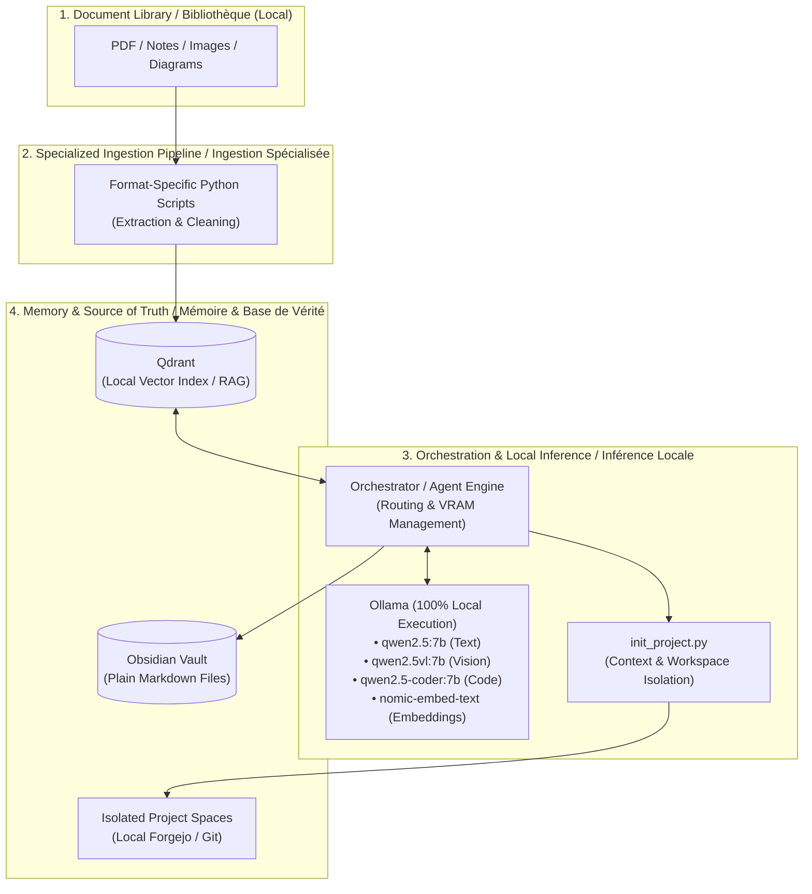

# Knowledge Lifecycle Management (KLM) — POC

🇬🇧 **[English version below](#-english-version)** | 🇫🇷 **[Version française ci-dessous](#-version-française)**

---

## 🇫🇷 Version Française

> **Un système agentique 100 % local et souverain qui transpose les principes du PLM (Product Lifecycle Management) à la gestion des connaissances personnelles, avec orchestration adaptative selon les ressources GPU disponibles.**

### 🎯 Vision & Problématique

La veille technique, l'apprentissage et la gestion de projets génèrent un flux continu de documents hétérogènes (PDF, captures d'écran, schémas, notes brutes, code). Les outils actuels imposent souvent un compromis : soit un tri manuel chronophage, soit l'externalisation de données sensibles vers des plateformes cloud propriétaires.

**Knowledge Lifecycle Management (KLM)** propose une approche **Local-First & Souveraine** :
1. **Cycle de vie maîtrisé :** Capture, nettoyage, extraction sémantique, synthèse, mise à jour et archivage des connaissances sur disque local.
2. **Déploiement adaptatif par profil matériel :** L'orchestrateur calibre l'enchaînement des modèles IA locaux en fonction de la VRAM disponible sur le PC de l'utilisateur (mode séquentiel sous contrainte 6 Go VRAM, mode concurrent sur 16 Go+ VRAM).
3. **Pérennité & Isolation :** Aucun format propriétaire. La mémoire vectorielle est gérée localement (**Qdrant**) et la connaissance consolidée est produite au format Markdown standard (**Obsidian**), avec un cloisonnement strict entre le coffre personnel et les espaces projets.

### 🏗️ Architecture du POC

### ⚙️ Fonctionnement & Gestion de la contrainte Hardware

* **Hardware actuel :** AMD Ryzen 7 4800H, 16 Go RAM, **NVIDIA GeForce GTX 1660 Ti (6 Go VRAM)**.
* **Exécution séquentielle (6 Go VRAM) :** L'`Agent Engine` pilote le chargement et le déchargement explicite des modèles via **Ollama** à chaque étape du workflow (extraction multimodale $\rightarrow$ vectorisation $\rightarrow$ interrogation RAG $\rightarrow$ synthèse Markdown) afin d'éviter toute saturation mémoire (`OOM`).
* **Scalabilité (16 Go+ VRAM) :** L'architecture est conçue pour basculer vers une exécution concurrente des modèles (maintien simultané de l'embedding, du LLM texte et du modèle vision en VRAM) et l'utilisation de fenêtres de contexte étendues dès que le matériel le permet.

### 🛠️ Stack Technique

* **Orchestration & Ingestion :** Python (architecture modulaire sur mesure, typage statique `mypy`, linting `ruff`, tests `pytest`).
* **Inférence IA Locale :** Ollama.
* **Modèles Locaux :** `qwen2.5:7b`, `qwen2.5vl:7b`, `qwen2.5-coder:7b`, `nomic-embed-text`.
* **Base Vectorielle (RAG) :** Qdrant (instance locale).
* **Restitution & Versioning :** Obsidian (Markdown local) et Forgejo / Git (gestion locale des dépôts).

### 🗺️ Feuille de route (Roadmap)

1. **Phase 1 — POC Personnel (Actuel) :** Stabilisation de l'ingestion multi-format et de la génération structurée vers Obsidian sous contrainte 6 Go VRAM.
2. **Phase 2 — Profilage GPU & Concurrence :** Détection automatique des capacités VRAM pour adapter dynamiquement le parallélisme des agents et la taille des contextes.
3. **Phase 3 — Fédération Décentralisée :** Mécanisme d'export et de synchronisation sélective de sous-ensembles de connaissances validées entre pairs via Git, sans serveur centralisé.

---

## 🇬🇧 English Version

> **A 100% local and sovereign agentic system applying PLM (Product Lifecycle Management) principles to personal knowledge management, featuring adaptive orchestration tailored to available GPU resources.**

### 🎯 Vision & Problem Statement

Technical research, continuous learning, and project management generate a constant stream of heterogeneous documents (PDFs, screenshots, diagrams, raw notes, source code). Existing tools often force a trade-off between time-consuming manual sorting and uploading sensitive data to proprietary cloud SaaS platforms.

**Knowledge Lifecycle Management (KLM)** introduces a **Local-First & Sovereign** approach:
1. **Controlled Lifecycle:** Local capture, cleaning, semantic extraction, synthesis, updating, and archiving of knowledge directly on disk.
2. **Hardware-Adaptive Deployment:** The orchestrator adjusts local AI model scheduling based on available VRAM on the user's PC (sequential execution under a 6 GB VRAM constraint, concurrent execution on 16 GB+ VRAM).
3. **Longevity & Isolation:** Zero proprietary formats. Vector memory runs locally (**Qdrant**) and consolidated knowledge is generated as standard plain-text Markdown files (**Obsidian**), maintaining strict isolation between the personal vault and project workspaces.

### ⚙️ Workflow & Hardware Constraint Management

* **Current Hardware:** AMD Ryzen 7 4800H, 16 GB RAM, **NVIDIA GeForce GTX 1660 Ti (6 GB VRAM)**.
* **Sequential Execution (6 GB VRAM):** The `Agent Engine` explicitly manages model loading and unloading via **Ollama** at each pipeline stage (multimodal extraction $\rightarrow$ vectorization $\rightarrow$ RAG retrieval $\rightarrow$ Markdown synthesis) to prevent Out-Of-Memory (`OOM`) errors.
* **Scalability (16 GB+ VRAM):** Designed to switch seamlessly to concurrent model execution (keeping embeddings, text LLM, and vision models loaded simultaneously in VRAM) alongside extended context windows on higher-tier GPUs.

### 🛠️ Tech Stack

* **Orchestration & Ingestion:** Python (custom modular architecture, static typing with `mypy`, linting with `ruff`, testing with `pytest`).
* **Local AI Inference:** Ollama.
* **Local Models:** `qwen2.5:7b`, `qwen2.5vl:7b`, `qwen2.5-coder:7b`, `nomic-embed-text`.
* **Vector Store (RAG):** Qdrant (local instance).
* **Knowledge Base & Versioning:** Obsidian (local Markdown) and Forgejo / Git (local repository management).

### 🗺️ Roadmap

1. **Phase 1 — Personal POC (Current):** Reliable multi-format ingestion and structured Markdown generation into Obsidian within a 6 GB VRAM envelope.
2. **Phase 2 — GPU Profiling & Concurrency:** Automatic VRAM detection to dynamically adjust agent parallelism and context window sizes.
3. **Phase 3 — Decentralized Federation:** Selective export and peer-to-peer synchronization of validated knowledge subsets via Git, with no central server.

---

*Submitted to the **ASUS Agent Computer Challenge** (AI Entry Category).*
